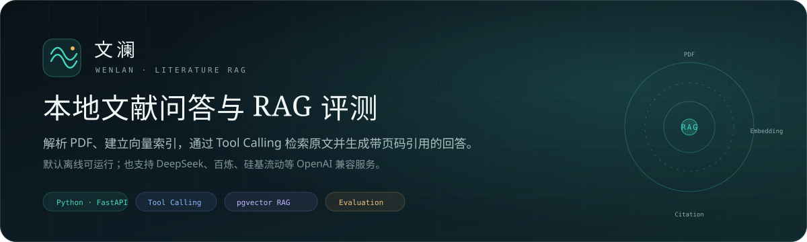
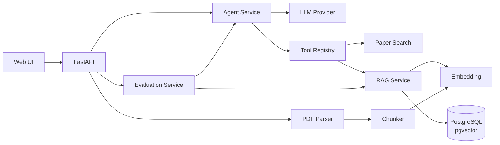

# 文澜 WenLan

基于 FastAPI、Tool Calling 与 pgvector 的本地文献问答与 RAG 评测项目。

[](https://www.python.org/)
[](https://github.com/fastapi/fastapi)
[](https://www.postgresql.org/)
[](https://github.com/pgvector/pgvector)
[](LICENSE)



文澜将 PDF 解析、文本分块、向量检索、Tool Calling 和多轮问答串成一条可运行的链路：上传论文后建立本地索引，模型通过工具检索原文，再生成带页码与引用的回答。

默认使用离线 Mock 模型与本地哈希向量，无需 API Key 即可启动；也可以接入 DeepSeek、通义千问、硅基流动等 OpenAI 兼容服务。

## 页面

当前 Web 界面包含五个主页面和一个配置面板，静态结构在 [`app/static/index.html`](app/static/index.html)，动态交互在 [`app/static/app.js`](app/static/app.js)。

| 页面 | 主要内容 |
| --- | --- |
| **总览** | 文献与 Chunk 统计、最近入库、处理流程、最近一次评测 |
| **科研问答** | 多轮会话、SSE 流式回答、引用证据、Tool Trace |
| **文献库** | PDF 上传、解析与索引状态、Chunk/页数、详情、重建索引、删除 |
| **找论文** | OpenAlex / arXiv / Crossref 检索，结果导入本地库 |
| **评测实验** | 检索评测、Agent 评测、完整评测、Chunk × Top-K 网格、Prompt 对比、历史记录 |
| **配置与说明** | 数据库、模型、Embedding 状态，模型接入说明与项目信息 |

## 功能

- **PDF 知识库**：PyMuPDF 解析、页级文本、章节识别、滑动窗口分块、SHA-256 去重
- **向量检索**：PostgreSQL 16 + pgvector，原生 `vector(1024)` 与 HNSW Cosine 索引
- **混合重排**：向量分数 + IDF 加权词法分数 + 标题/主题别名
- **Tool Calling**：5 个工具，支持多轮工具调用与工具结果回传
- **引用溯源**：回答中的 `[n]` 对应具体 Chunk、章节和页码
- **论文检索**：OpenAlex / arXiv / Crossref 聚合检索，arXiv 结果可自动下载 PDF
- **离线模式**：Mock LLM + 本地哈希向量，无需外部服务即可跑通完整流程
- **评测**：Recall@K、MRR、nDCG@K、Tool Calling Accuracy、Task Success Rate、Citation Hit Rate
- **参数实验**：Chunk × Overlap × Top-K 网格，Prompt 变体对比
- **零构建前端**：原生 HTML/CSS/JS，无需 Node.js
- **本地数据库**：通过 `pgserver` 安装并启动 PostgreSQL + pgvector，无需 Docker

## 架构




### Agent 工具

| 工具 | 说明 |
| --- | --- |
| `search_papers` | 检索本地论文元数据 |
| `get_paper_detail` | 作者、年份、摘要、DOI、章节、索引状态 |
| `search_library` | 在 PDF 知识库中检索原文片段 |
| `list_library_papers` | 列出库内论文 |
| `search_online_papers` | 联网检索 OpenAlex / arXiv |

## 快速开始

要求 Python 3.11 / 3.12（64 位）。不需要预先安装 PostgreSQL、pgvector 或 Docker。

### Windows

```bat
python -m venv .venv
call .venv\Scripts\activate
python -m pip install -U pip
pip install -e ".[dev]"

copy .env.example .env
python -m app.cli init-db
python -m app.cli serve
```

也可以运行：

```bat
scripts\start.bat
```

该脚本会创建虚拟环境、安装依赖、初始化数据库并启动服务。示例文献库不会自动导入，可在页面中手动选择，或执行：

```bat
python -m app.cli seed
```

### macOS / Linux

```bash
python3.12 -m venv .venv
source .venv/bin/activate
pip install -e ".[dev]"
cp .env.example .env
python -m app.cli init-db
python -m app.cli serve
```

### Docker（可选）

```bash
docker compose up --build
```

Compose 使用 `pgvector/pgvector:pg16`，并设置 `USE_EMBEDDED_POSTGRES=false` 和外部 `DATABASE_URL`。默认本地模式不需要 Docker。

## 模型配置

不配置 Key 时，项目会使用离线 Mock 和本地哈希向量。需要更自然的回答时，复制 `.env.example` 为 `.env`，填写任意一组：

```dotenv
# DeepSeek + 硅基流动
LLM_PROVIDER=deepseek
DEEPSEEK_API_KEY=sk-...
LLM_MODEL=deepseek-chat

EMBEDDING_PROVIDER=siliconflow
SILICONFLOW_API_KEY=sk-...
EMBEDDING_MODEL=BAAI/bge-m3
EMBEDDING_DIM=1024
```

```dotenv
# 阿里云百炼 / 通义千问
LLM_PROVIDER=dashscope
DASHSCOPE_API_KEY=sk-...
LLM_MODEL=qwen-plus

EMBEDDING_PROVIDER=dashscope
EMBEDDING_MODEL=text-embedding-v4
EMBEDDING_DIM=1024
```

| 提供商 | 环境变量 | 默认模型 |
| --- | --- | --- |
| DeepSeek | `DEEPSEEK_API_KEY` | `deepseek-chat` |
| 阿里云百炼 | `DASHSCOPE_API_KEY` | `qwen-plus` |
| 硅基流动 | `SILICONFLOW_API_KEY` | `Qwen/Qwen2.5-72B-Instruct` / `BAAI/bge-m3` |
| Kimi | `MOONSHOT_API_KEY` | `moonshot-v1-8k` |
| 智谱 GLM | `ZHIPU_API_KEY` | `glm-4-plus` |

`LLM_PROVIDER=auto` 会按 DeepSeek → 百炼 → 硅基流动 → Kimi → 智谱 的顺序检测 Key；没有 Key 时进入离线演示模式。

> 更换 Embedding 模型或维度后，需要重建索引。只重算现有文档可调用 `POST /api/library/reindex`。

## 评测

评测集位于 [`data/eval/dataset.jsonl`](data/eval/dataset.jsonl)，包含 25 条中文用例，覆盖原文问答、论文检索、元数据与多轮指代。

| 指标 | 说明 |
| --- | --- |
| Recall@K | 相关论文进入 Top-K 的比例 |
| MRR | 首个相关结果排名的倒数均值 |
| nDCG@K | 考虑排序位置的归一化增益 |
| Tool Calling Accuracy | 必需工具被调用的比例 |
| Task Success Rate | 关键词、引用、拒答与错误的综合判定 |
| Citation Hit Rate | 实际引用命中相关论文的比例 |

默认 seed 语料上的离线基线（10 篇论文 / 45 个 Chunk，Mock + 本地 Embedding）：

| 指标 | 结果 |
| --- | ---: |
| Recall@6 | 100.0% |
| MRR | 0.980 |
| Tool Calling Accuracy | 100.0% |
| Task Success Rate | 96.0% |
| Citation Hit Rate | 88.0% |

这组数字用于验证工程链路和评测管线，不代表真实模型或真实论文全文上的效果。

参数实验支持：

```bash
python -m app.cli eval --kind full --limit 25 --top-k 6
python -m app.cli experiments --kind retrieval_grid --limit 25
python -m app.cli experiments --kind prompt_grid --limit 10
```

更完整的方法和结果见 [docs/EVALUATION.md](docs/EVALUATION.md)。

## 命令行

```bash
python -m app.cli init-db                 # 初始化数据库与 pgvector
python -m app.cli seed                    # 导入 10 篇示例论文
python -m app.cli seed --download         # 尝试下载真实 arXiv PDF
python -m app.cli serve                   # 启动 Web 服务
python -m app.cli status                  # 查看配置与数据统计
python -m app.cli eval --kind full        # 运行评测
python -m app.cli experiments --kind retrieval_grid
python -m app.cli reset-db --yes          # 删除并重建所有表（危险）
```

## API


| Method | Path | 说明 |
| --- | --- | --- |
| GET | `/api/health` | 健康检查 |
| GET | `/api/system/info` | 系统状态与统计 |
| GET | `/api/papers` | 文献列表 |
| POST | `/api/papers/upload` | 上传 PDF |
| GET | `/api/papers/{id}` | 论文详情 |
| GET | `/api/papers/{id}/pdf` | 本地 PDF |
| POST | `/api/papers/{id}/reindex` | 重建单篇索引 |
| POST | `/api/rag/search` | 直接执行语义检索 |
| GET | `/api/discovery/search` | 找论文 |
| POST | `/api/discovery/import` | 导入检索结果 |
| POST | `/api/chat` | 非流式问答 |
| POST | `/api/chat/stream` | SSE 流式问答 |
| GET | `/api/conversations` | 会话列表 |
| POST | `/api/evaluations/run` | 启动评测或实验 |
| GET | `/api/evaluations/runs` | 历史结果 |

更多示例见 [docs/API.md](docs/API.md)。

## 目录结构

```text
.
├─ app/
│  ├─ api/                 # FastAPI 路由
│  ├─ services/            # PDF、分块、Embedding、RAG、Agent、评测
│  ├─ static/              # 原生 HTML/CSS/JS 前端
│  ├─ config.py            # 配置
│  ├─ db.py                # pgserver / PostgreSQL / SQLite
│  ├─ models.py            # SQLAlchemy 模型
│  └─ main.py              # 应用入口
├─ data/
│  ├─ seed/papers.json     # 示例论文元数据
│  ├─ eval/dataset.jsonl   # 评测集
│  └─ uploads/             # 本地 PDF（运行后生成）
├─ docs/                   # 架构、评测、API、banner
├─ tests/                  # pytest
├─ scripts/                # 启动与检查脚本
├─ .github/workflows/      # GitHub Actions
├─ pyproject.toml
├─ docker-compose.yml
└─ .env.example
```

## 设计说明

- **嵌入式 PostgreSQL**：`pgserver` 提供可 pip 安装的 PostgreSQL 16 + pgvector，保留外部 PostgreSQL 和 Compose 两种部署方式。
- **双数据库后端**：默认 PostgreSQL/pgvector；SQLite 仅用于测试，向量由应用层计算。
- **章节感知分块**：识别摘要、方法、实验、结论等标题，按句切分并保留重叠。
- **混合检索**：向量召回后结合 IDF 加权词法分数与标题/别名加权，改善缩写和中文提问。
- **全局引用编号**：多轮工具调用复用同一 Chunk 的编号，避免 `[1]` 冲突。
- **离线 Mock**：工具调用和数据库检索是真实的，只是 LLM 与 Embedding 使用离线替身；适合流程验证和回归。

## 已知限制

- 扫描版 PDF 暂未接入 OCR；
- 未加入 bge-reranker 等专用重排模型；
- 未实现登录、权限、多租户和公网部署防护；
- 评测集绑定默认示例论文，新上传论文不会自动进入评测；
- 示例库中的 `seed-demo` PDF 是生成的摘要笔记，不是原始论文全文；
- 模型回答和引用仍可能出错，重要结论需要回看原文；
- 当前没有 Alembic 迁移，数据库结构由 `create_all` 管理。

## 参考项目与论文

项目为独立实现，未直接复制第三方代码。以下项目与论文提供了设计参考：

- [fastapi/fastapi](https://github.com/fastapi/fastapi) — Web API
- [sqlalchemy/sqlalchemy](https://github.com/sqlalchemy/sqlalchemy) — ORM
- [pgvector/pgvector](https://github.com/pgvector/pgvector) — PostgreSQL 向量检索
- [orm011/pgserver](https://github.com/orm011/pgserver) — 嵌入式 PostgreSQL 启动
- [pymupdf/PyMuPDF](https://github.com/pymupdf/PyMuPDF) — PDF 解析
- [facebookresearch/DPR](https://github.com/facebookresearch/DPR) — 稠密检索
- [ysymyth/ReAct](https://github.com/ysymyth/ReAct) — 推理与行动
- [AkariAsai/Self-RAG](https://github.com/AkariAsai/Self-RAG) — 自适应检索与反思
- [microsoft/graphrag](https://github.com/microsoft/graphrag) — 图谱检索与全局摘要

论文：RAG、DPR、ColBERT、ReAct、Toolformer、Self-RAG、Lost in the Middle、Chain-of-Thought、GraphRAG、CRAG。

## License

MIT
